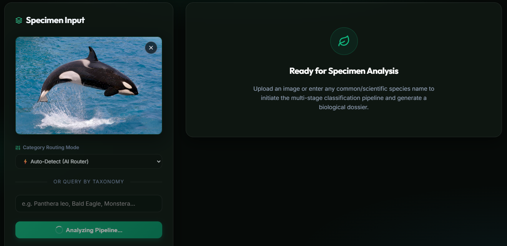
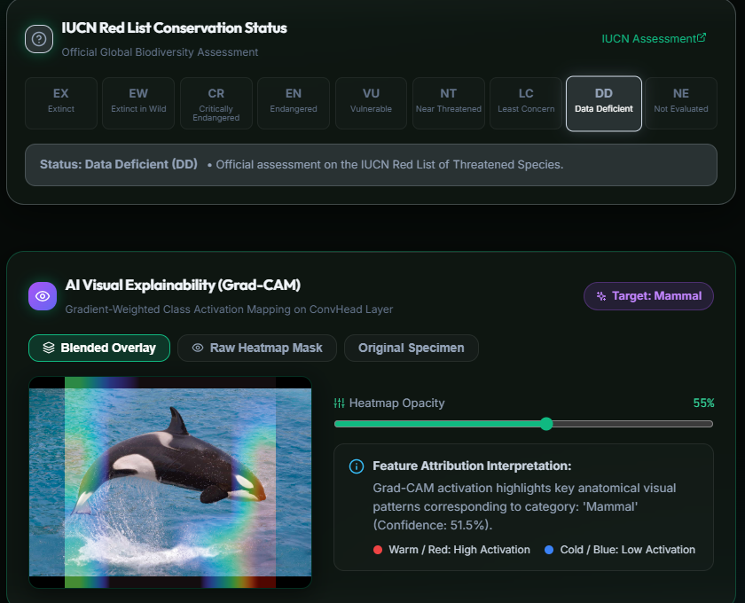
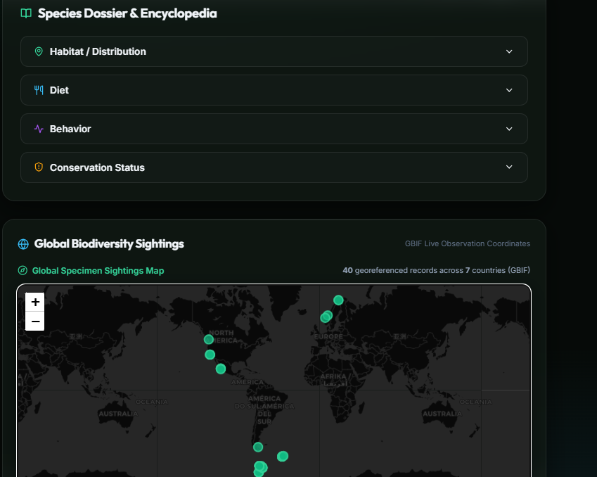
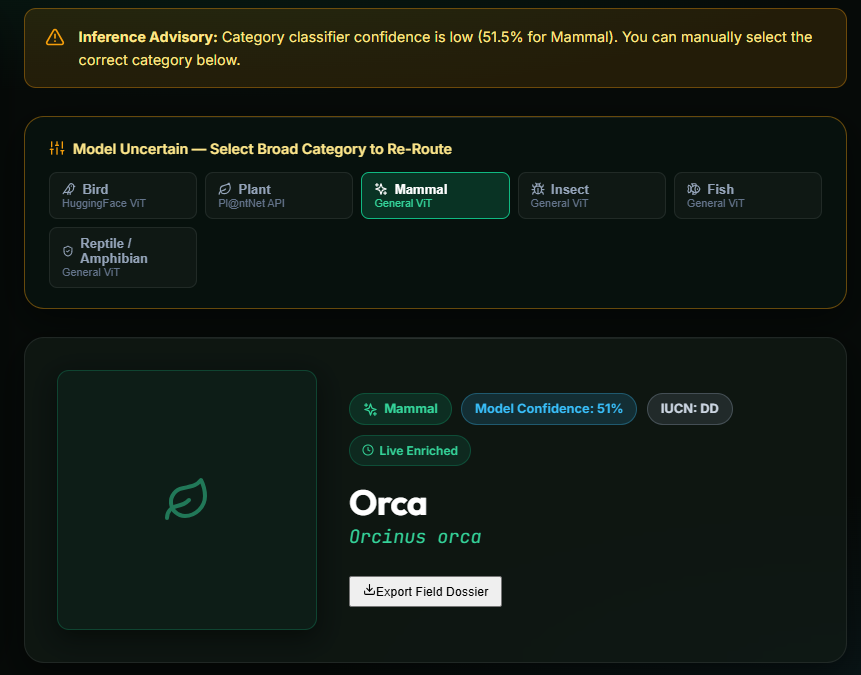
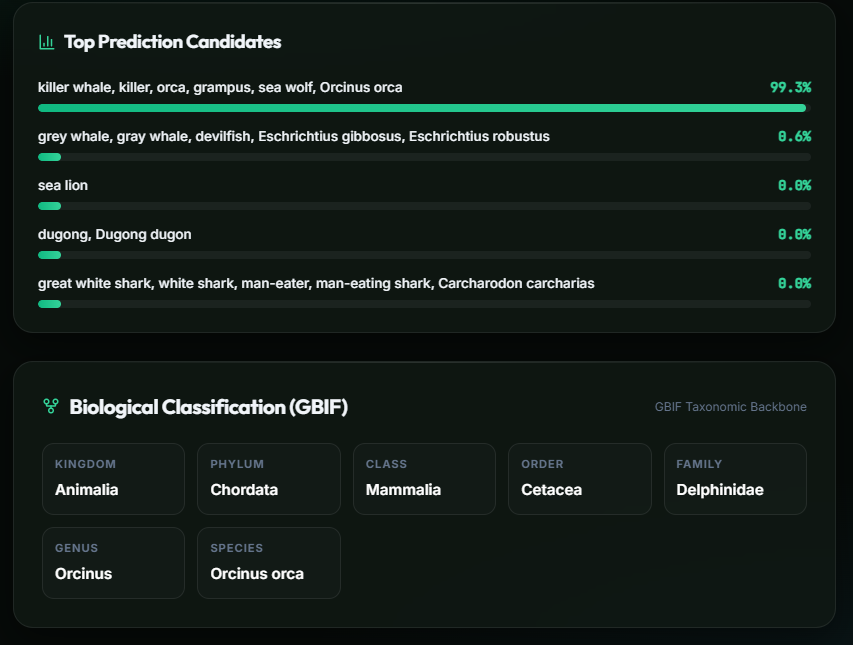
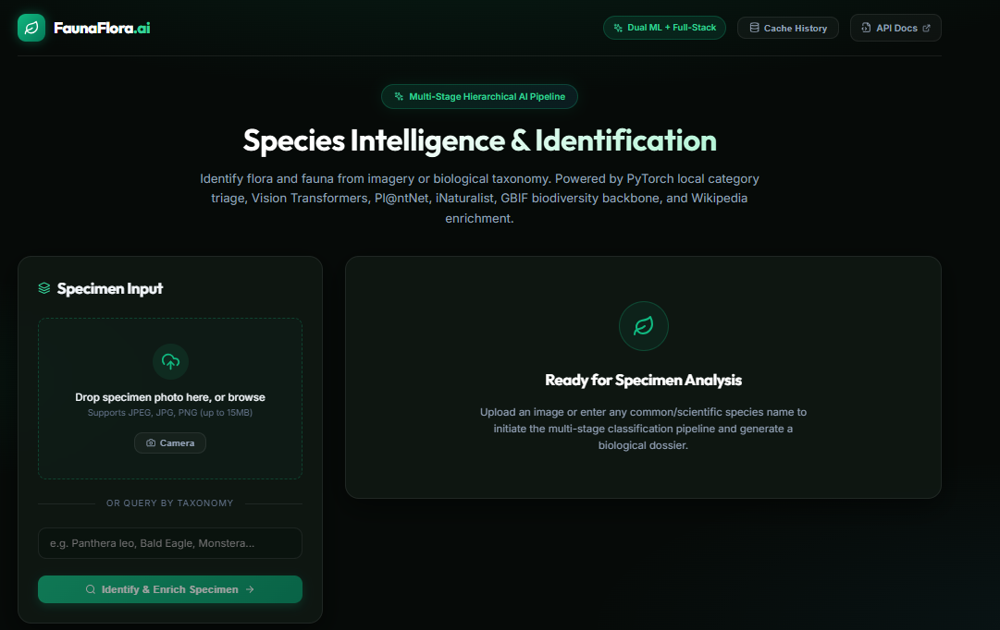

# FaunaFlora AI - Species Identification & Biodiversity Intelligence System

[](https://www.python.org/)
[](https://pytorch.org/)
[](https://fastapi.tiangolo.com/)
[](https://react.dev/)
[](https://vitejs.dev/)
[](https://leafletjs.com/)
[](https://www.sqlite.org/)
[](https://opensource.org/licenses/MIT)

An intelligent, full-stack biodiversity platform that identifies biological species from photographs or text queries. The system combines a **hierarchical multi-stage ML pipeline**, visual explainability (**Grad-CAM**), geospatial observation mapping (**GBIF + Leaflet**), official **IUCN Red List** conservation ratings, and encyclopedic knowledge enrichment.

---

## 🎯 1. Problem Statement & Core Value Proposition

### Why Naive Species Identification Fails
Standard computer vision and nature recognition apps suffer from key architectural and biological failure modes:
1. **Flat 10,000+ Class Imbalance & Memory Bloat:** Training a single monolithic model across millions of living taxa causes catastrophic forgetting, poor generalization on rare species, and huge memory footprints that cannot run on modest servers.
2. **Black-Box Trust Deficit:** In ecological surveys and wildlife science, researchers cannot trust a raw classification label without knowing whether the neural network focused on authentic anatomical field marks (beaks, plumage patterns, leaf veins) or background noise (grass, sky).
3. **Vernacular Name Ambiguity:** Common names vary wildly across regions (e.g., "Robin" refers to *Turdus migratorius* in the Americas but *Erithacus rubecula* in Europe), causing data errors without binomial scientific nomenclature (*Genus species*).
4. **Multi-Source Network Latency & Rate Limits:** Querying separate external systems sequentially for taxonomy (GBIF), common names (iNaturalist), threat status (IUCN), and natural history (Wikipedia) introduces 2–3s delays and rate-limit errors.

### Core Value Proposition
FaunaFlora AI resolves these limitations through a **two-stage coarse-to-fine router** (a lightweight local PyTorch EfficientNet-B0 model triages specimens in ~116ms to domain specialists), **native PyTorch Grad-CAM visual heatmaps**, **multi-source API normalization**, and an **embedded SQLite cache delivering $<2\text{ms}$ lookups** (**1,196x speedup**).

---

## 🌟 2. Key Features & Visual Walkthrough

| 📸 Specimen Upload & Camera Dropzone | 🛡️ IUCN Status & Grad-CAM Heatmap |
| :---: | :---: |
|  |  |
| *Drag-and-drop dropzone, live device camera, and 1-click sample chips* | *Official 9-tier IUCN threat spectrum meter with Grad-CAM visual attention* |

<p align="center">
  <br/>
  <em>Interactive dark-mode Leaflet GIS world sightings map and comprehensive biological field dossier</em>
</p>

<details>
<summary>📸 <strong>Click to view remaining interface workflows (Triage Probabilities, Classification Tree, & Research Dashboard)</strong></summary>

| 🧬 Broad Category Triage Probabilities | 🌳 Taxonomic Hierarchy Tree |
| :---: | :---: |
|  |  |
| *6-class coarse triage probabilities with low-confidence override* | *7-rank taxonomic classification tree from Kingdom to Species* |

<p align="center">
  <br/>
  <em>Alternative standalone Streamlit research dashboard with query history drawer</em>
</p>
</details>

* **Hierarchical Coarse-to-Fine Identification:** Sub-120ms local PyTorch triage routes specimens to specialized downstream models (Bird Vision Transformers, Pl@ntNet Botany API, or General Wildlife ViT).
* **Native Visual Explainability (Grad-CAM):** Dynamic heatmap slider blends class activation maps over raw photographs, visually verifying model focus on authentic anatomical features.
* **Geospatial GIS Observation Mapping:** Interactive Leaflet dark map rendering live georeferenced observation coordinates from GBIF.
* **IUCN Red List Conservation Spectrum:** 9-tier visual extinction risk meter linking directly to global species assessments.
* **1-Click Field Dossier Export:** Instant formatted Markdown field reports and print-optimized PDF generation.
* **Persistent SQLite Caching:** Local cache-aside layer delivering $<2\text{ms}$ response times on repeated queries.

---

## 🏗️ 3. System Architecture & Request Lifecycle

```
                      [Specimen Image / Species Name]
                                     │
                                     ▼
                     ┌───────────────────────────────┐
                     │  Stage 1: Broad Categorizer   │  <-- PyTorch EfficientNet-B0
                     │ (Bird, Plant, Mammal, Insect, │      Fast coarse triage (~116ms)
                     │   Fish, Reptile/Amphibian)    │
                     └───────────────┬───────────────┘
                                     │
                ┌────────────────────┼────────────────────┐
                ▼                    ▼                    ▼
       ┌──────────────────┐ ┌──────────────────┐ ┌──────────────────┐
       │   Bird ViT       │ │   Pl@ntNet API   │ │   General ViT    │
       │ (HuggingFace)    │ │ (Botany Expert)  │ │ (Vision Transf.) │
       └────────┬─────────┘ └────────┬─────────┘ └────────┬─────────┘
                │                    │                    │
                └────────────────────┼────────────────────┘
                                     │
                                     ▼
                     ┌───────────────────────────────┐
                     │ Stage 2: Visual Explainability│  <-- Native PyTorch Grad-CAM
                     │ (Grad-CAM on model.conv_head) │      Turbo colormap blend
                     └───────────────┬───────────────┘
                                     │
                                     ▼
                     ┌───────────────────────────────┐
                     │  Stage 3: Taxon Normalization │  <-- iNaturalist API
                     │   (Common ⟷ Scientific Name) │
                     └───────────────┬───────────────┘
                                     │
                                     ▼
                     ┌───────────────────────────────┐
                     │    Multi-Tier SQLite Cache    │  <-- <2ms cached response
                     │     (db/species_cache.db)     │
                     └───────┬───────────────┬───────┘
                       HIT   │               │ MISS
                             │               ▼
                             │    ┌──────────────────────────┐
                             │    │ GBIF Taxonomy & Regions  │
                             │    │ GBIF Sighting Coords     │
                             │    │ IUCN Red List Status     │
                             │    │ Wikipedia Encyclopedia   │
                             │    └──────────┬───────────────┘
                             │               │
                             └───────┬───────┘
                                     │
                                     ▼
                     ┌───────────────────────────────┐
                     │      Biological Dossier       │
                     │  • Taxonomy Hierarchy Tree    │
                     │  • Grad-CAM Visual Heatmap    │
                     │  • Interactive Sighting Map   │
                     │  • IUCN Conservation Status   │
                     │  • Field Dossier (.md / .pdf) │
                     └───────────────────────────────┘
```

---

## ⚡ 4. Key Highlights & Benchmarked Performance

Measured under `Python 3.11` on standard CPU hardware via the automated benchmark suite (`scripts/benchmark.py`):

| Component / Layer | Metric | Measured Value | Operational Rationale |
| :--- | :--- | :--- | :--- |
| **Model Footprint** | Checkpoint Size | **`15.66 MB`** | Standalone PyTorch `.pt` model; zero external cloud dependencies |
| **Model Parameters** | Total Weights | **`4,015,234`** | Compact 4.02M-parameter EfficientNet-B0 architecture |
| **PyTorch Triage (CPU)**| P50 Median Latency | **`116.94 ms`** | Sub-120ms initial category routing on standard CPU |
| **PyTorch Triage (CPU)**| Mean Latency | **`162.25 ms`** | Evaluated across 50 consecutive benchmark iterations |
| **Grad-CAM XAI** | Heatmap Generation | **`788.67 ms`** | Backpropagation hooks on `model.conv_head` + Turbo colormap |
| **SQLite Cache Retrieval**| Read Latency | **`1.546 ms`** | Instant local retrieval from persistent JSON store |
| **Cache Acceleration**| Speedup Factor | **`1,196.7x ⚡`** | Compared to ~1,850ms sequential live external API calls |
| **Field Dossier Gen** | Generation Time | **`0.0505 ms`** | High-throughput export (>19,800 dossiers/second) |
| **FastAPI Health Gateway**| Latency (`/health`)| **`3.41 ms`** | Asynchronous ASGI request turnaround |
| **FastAPI Samples** | Latency (`/samples`) | **`2.62 ms`** | Instant showcase data response |

---

## 🚀 5. Tech Stack & Engineering Rationale

| Layer | Technology | Version | Engineering Rationale |
| :--- | :--- | :--- | :--- |
| **Frontend UI** | React | `18.2.0` | Declarative component state management and glassmorphic modal drawers |
| **Build Tool & Bundler** | Vite | `^5.1.6` | Sub-second Hot Module Replacement (HMR) and optimized production bundles |
| **Geospatial GIS** | Leaflet | `1.9.4` | Lightweight interactive dark world maps with georeferenced specimen markers |
| **Icons & Design** | Lucide React / CSS3 | `0.344.0` | Custom glassmorphic dark-forest design tokens, blur filters, and SVG icons |
| **Backend REST Gateway**| FastAPI | `>= 0.110.0` | Asynchronous ASGI REST endpoints, non-blocking I/O, and auto Swagger docs |
| **ASGI Server** | Uvicorn | `>= 0.28.0` | High-throughput asynchronous event loop server executing Python coroutines |
| **Data Validation** | Pydantic | `v2.x` | Strict type coercion and automated OpenAPI schema generation |
| **Machine Learning** | PyTorch | `2.x` | Native forward/backward hooks for Grad-CAM explainability and CPU inference |
| **Model Architecture** | EfficientNet-B0 | Fine-tuned | Compact 4.02M-parameter neural network providing sub-120ms coarse triage |
| **Computer Vision** | HuggingFace Transformers | `4.x` | Domain-specialist Vision Transformers for fine-grained bird and animal species |
| **Botanical Vision** | Pl@ntNet API | `v2` | Specialized external botanical identification engine for flora specimens |
| **Taxon Normalization**| iNaturalist API | `v1` | Bidirectional resolution between common vernacular names and scientific Latin taxa |
| **Biodiversity Data** | GBIF Backbone API | `v1` | Global taxonomic trees, 40+ observation coordinates, and threat assessments |
| **Persistence Cache** | SQLite3 | `3.x` | Embedded zero-dependency cache-aside storage delivering $<2\text{ms}$ reads |
| **Alternative UI** | Streamlit | `1.32+` | Standalone single-file research dashboard for rapid data experimentation |

---

## 🏛️ 6. Key Architectural Decisions

| ADR ID | Decision Title | Status | Context & Problem | Chosen Solution & Trade-offs |
|:---|:---|:---:|:---|:---|
| **ADR-01** | TFLite to PyTorch Classifier Migration | **Accepted** | TFLite caused frequent container build failures and stripped backward graphs, blocking Grad-CAM. | Migrated to PyTorch `EfficientNet-B0` (`.pt`). Native forward/backward hooks enabled Grad-CAM. Trade-off: Model size increased from 4.2MB to 15.66MB. |
| **ADR-02** | Hierarchical Triage vs. Monolithic Model | **Accepted** | Flat 10,000+ class models suffer from severe class imbalance and catastrophic forgetting. | 2-stage architecture: Fast coarse triage (~116ms) routes to specialized expert models. Trade-off: Two sequential inference passes. |
| **ADR-03** | Decoupling Streamlit to FastAPI + React SPA | **Accepted** | Streamlit re-executes on every click, restricting custom Leaflet GIS mapping and async API calls. | Decoupled into an asynchronous FastAPI gateway + React 18 glassmorphic web app. Trade-off: Managing two runtimes in development. |
| **ADR-04** | SQLite Cache-Aside vs. Live Multi-API Calls | **Accepted** | Sequential calls to GBIF, iNaturalist, and Wikipedia took 2–3s and hit rate limits. | Persistent SQLite cache-aside store (`species_cache.db`) delivering **1.5ms** reads (**1,196x speedup**). Trade-off: Local disk cache storage. |
| **ADR-05** | Local Transformers Caching vs. Cloud APIs | **Accepted** | Cloud inference APIs caused 20s+ cold starts and required paid API subscriptions. | Locally cached HuggingFace Vision Transformers in `models/hf_cache/` with singleton lazy loading. Trade-off: Requires ~340MB local disk space. |

---

## 📁 7. Repository & Codebase Structure

```
species-info-app/
├── api/                              # FastAPI Gateway & Data Validation
│   ├── __init__.py
│   ├── main.py                       # REST routes, CORS, static mounting & export
│   └── schemas.py                    # Pydantic v2 validation models
├── frontend/                         # Modern React 18 + Vite Frontend
│   ├── src/
│   │   ├── components/               # UI components (Dropzone, Map, XAI Viewer, Dossier)
│   │   ├── App.jsx                   # Central application state & pipeline controller
│   │   └── index.css                 # Glassmorphic dark-forest design system
│   ├── package.json
│   └── vite.config.js                # Vite configuration with /api proxy
├── models/                           # PyTorch ML Models & Cache
│   ├── broad_category_classifier_full.pt # Fine-tuned PyTorch EfficientNet-B0 (15.66 MB)
│   └── hf_cache/                     # Locally cached Vision Transformer weights
├── screenshots/                      # Application documentation screenshots
├── scripts/                          # Benchmarking & Utilities
│   └── benchmark.py                  # Quantitative latency, XAI & cache benchmark suite
├── services/                         # Core Machine Learning & API Integrations
│   ├── local_classifier.py           # PyTorch broad category classifier
│   ├── explainability.py             # Grad-CAM activation heatmap generator
│   ├── api_huggingface.py            # HuggingFace Vision Transformers (ViT)
│   ├── api_plantnet.py               # Pl@ntNet Botany API integration
│   ├── api_gbif.py                   # GBIF taxonomy, coordinates & IUCN status
│   ├── api_inaturalist.py            # Taxon name mapping & resolution
│   ├── api_wikipedia.py              # Wikipedia structured section parser
│   ├── db_handler.py                 # SQLite cache CRUD with auto-migrations
│   └── report_generator.py           # Markdown field dossier generator
├── db/                               # Database Storage
│   └── species_cache.db              # SQLite persistent cache
├── tests/                            # Automated Unit Test Suite (9 Tests)
│   ├── test_api_endpoints.py
│   ├── test_explainability.py
│   └── test_api_gbif.py
├── app.py                            # Streamlit standalone dashboard
├── requirements.txt                  # Python backend dependencies
└── README.md
```

---

## ⚙️ 8. Installation & Developer Runbook

### Prerequisites
* **Python 3.10+** (tested on Python 3.11)
* **Node.js 18+** and **npm**

### 1. Environment Setup
```bash
git clone https://github.com/karnesh7/species-info-app.git
cd species-info-app

# Create and activate virtual environment
python -m venv venv
.\venv\Scripts\activate   # Windows
# source venv/bin/activate  # macOS / Linux

# Install backend dependencies
pip install -r requirements.txt
```

### 2. Environment Configuration
Create a `.env` file in the project root:

| Variable | Description | Requirement |
| :--- | :--- | :--- |
| `PLANTNET_API_KEY` | Botanical identification API key from Pl@ntNet | Optional (falls back gracefully) |
| `HF_TOKEN` | HuggingFace user token for downloading ViT checkpoints | Optional (public weights supported) |

### 3. Launching the Application

#### Option A: Full-Stack Web App (Recommended)
```bash
# Terminal 1: Start FastAPI Backend
uvicorn api.main:app --reload --port 8000

# Terminal 2: Start React Frontend
cd frontend
npm install
npm run dev
```
*Frontend runs at `http://localhost:5173` | Backend API docs at `http://localhost:8000/docs`.*

#### Option B: Production Single-Server Bundle
```bash
cd frontend && npm run build && cd ..
uvicorn api.main:app --port 8000
```
*Single server running both frontend and API at `http://localhost:8000`.*

#### Option C: Standalone Streamlit Dashboard
```bash
streamlit run app.py
```
*Streamlit dashboard runs at `http://localhost:8501`.*

---

## 📡 9. API Reference

All endpoints return JSON and are interactive via `/docs` (Swagger UI):

| Method | Endpoint | Description | Key Parameters |
| :--- | :--- | :--- | :--- |
| `POST` | `/api/identify` | Identifies species from photo upload or text query | `image` (UploadFile), `species_name` (Form), `category_override` (Form) |
| `GET` | `/api/species/{name}` | Direct taxonomy, sightings, and encyclopedia lookup | `name` (Common or scientific Latin name) |
| `GET` | `/api/species/{name}/export` | Download formatted Markdown field dossier | `name` (Returns `.md` file attachment) |
| `GET` | `/api/samples` | Curated showcase specimens for 1-click exploration | None |
| `GET` | `/api/history` | List recent cached queries from SQLite database | `limit` (Query param, default: 20) |
| `GET` | `/api/health` | Service, model checkpoint, and database health check | None |

---

## 🧪 10. Automated Testing & Verification

### Run Automated Unit Test Suite
```bash
python -m unittest discover tests -v
```
*Executes 9 automated unit tests verifying FastAPI routes, Grad-CAM backprop hooks, GBIF GIS/IUCN queries, iNaturalist resolution, and field dossier generators.*

### Run Empirical Latency & Performance Benchmarks
```bash
python scripts/benchmark.py
```
*Measures local PyTorch triage latency, Grad-CAM heatmap generation, and SQLite cache read acceleration, saving outputs to `benchmarks/benchmark_results.json`.*

---

## 🗺️ 11. Roadmap & Engineering Directions

- [ ] **Audio Birdsong & Bioacoustic Identification:** Allow users to record or upload audio clips (e.g., birdsong or frog calls) to identify species by sound alongside photographs.
- [ ] **Offline Mobile Field Mode:** Package the local triage classifier into a lightweight Progressive Web App (PWA) with cached field guides for remote, internet-free wildlife reserves.
- [ ] **Multi-Organism Detection in Single Photos:** Detect and draw bounding boxes around multiple distinct plants or animals in a single field photo to identify each organism independently.

---

## 📄 12. License

Distributed under the [MIT License](LICENSE).
