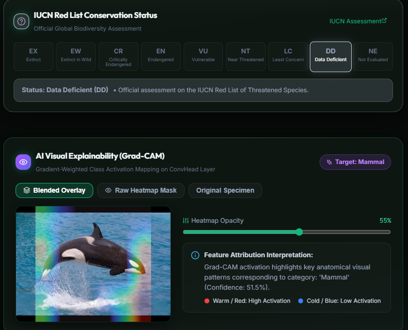
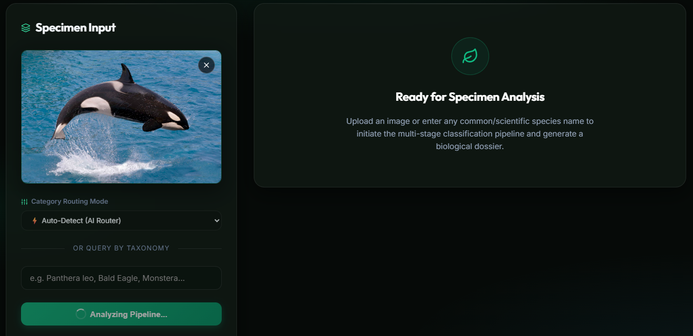
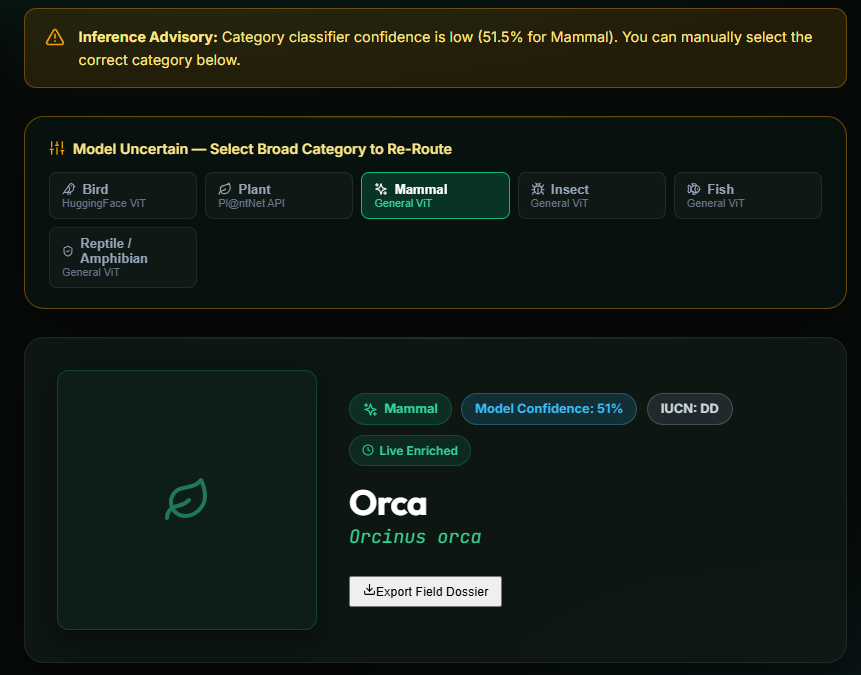
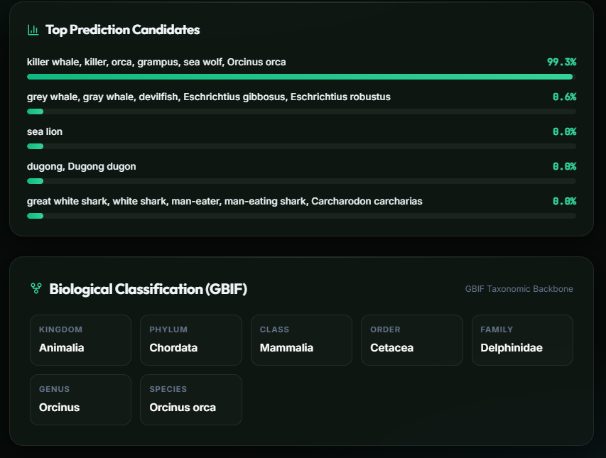
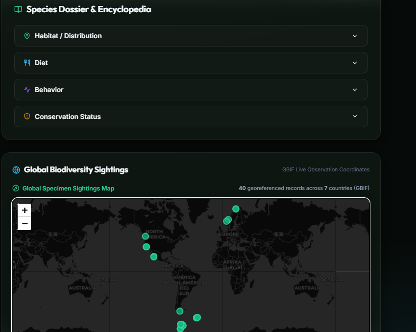
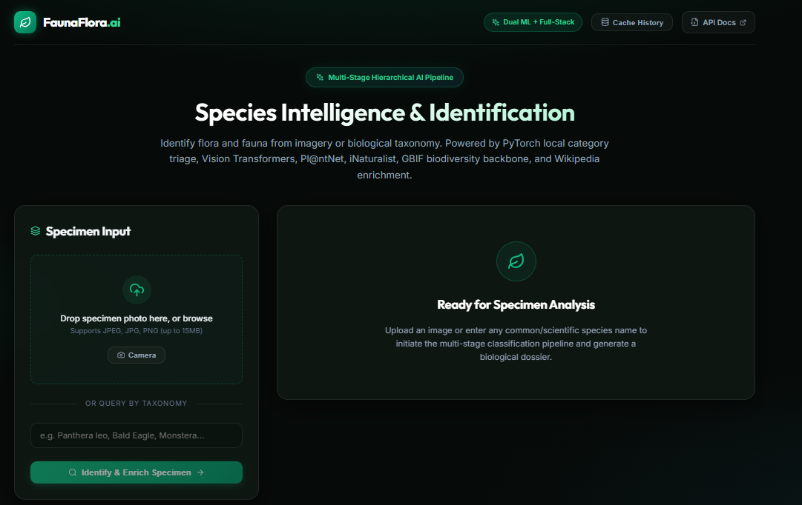

# FaunaFlora AI — Biodiversity Intelligence & Species Identification

> Intelligent full-stack biological classification platform combining hierarchical ML triage, native Grad-CAM explainability, and Leaflet GIS mapping.

[](https://www.python.org/)
[](https://pytorch.org/)
[](https://fastapi.tiangolo.com/)
[](https://react.dev/)
[](https://vitejs.dev/)
[](https://leafletjs.com/)
[](https://www.sqlite.org/)
[](LICENSE)

An intelligent nature intelligence system ("Shazam for Nature") that classifies biological specimens from field photos or names. Eliminates flat-catalog failure modes through a two-stage coarse-to-fine ML pipeline, visual explainability heatmaps, georeferenced GIS sightings, and sub-2ms cache-aside lookups.

```text
⚡ 116.9 ms P50 CPU Triage  ·  🔍 788.7 ms Grad-CAM XAI  ·  ⚡ 1,196.7x Cache Speedup  ·  🛡️ 9/9 Tests Passing
```

---

<!-- ════════════════════════════════════════════════════════════════════════════
     HERO ZONE — Recruiter completes here (First 1–2 scrolls, <75 lines)
     ════════════════════════════════════════════════════════════════════════════ -->

## 🌟 1. Key Features & Visual Walkthrough

<p align="center">
  <br/>
  <em>Native PyTorch Grad-CAM visual attention heatmap with dynamic opacity blending and official IUCN Red List threat spectrum</em>
</p>

<details>
<summary>📸 <strong>Click to view additional interface workflows (Upload, Triage, Taxonomy Tree & Sightings Map)</strong></summary>
<br>

<p align="center">
  <br/>
  <em>Specimen photo upload dropzone with category override controls and specimen query input</em>
</p>

<p align="center">
  <br/>
  <em>Sub-120ms coarse triage classifier routing across 6 broad biological kingdom classes</em>
</p>

<p align="center">
  <br/>
  <em>7-rank biological taxonomic classification hierarchy tree resolved via GBIF backbone</em>
</p>

<p align="center">
  <br/>
  <em>Interactive Leaflet dark-mode world map plotting georeferenced GBIF observation coordinates</em>
</p>

<p align="center">
  <br/>
  <em>Standalone single-file Streamlit research dashboard for rapid data experimentation</em>
</p>

</details>

* ⚡ **Hierarchical Coarse-to-Fine Triage:** Sub-120ms local PyTorch classifier routes specimens across 6 kingdoms to domain-specialist Vision Transformers.
* 🔍 **Native Visual Explainability (Grad-CAM):** Native PyTorch tensor hooks on `conv_head` blend a 5th-order polynomial Turbo heatmap over raw photos.
* 🗺️ **Geospatial GIS Observation Mapping:** Interactive Leaflet dark world map plotting live georeferenced coordinates ($N=40$) from GBIF.
* 🛡️ **9-Tier IUCN Threat Meter & Cache:** Visual extinction risk meter with embedded SQLite persistence delivering `<2 ms` cached lookups.

---

## ⚡ 2. Benchmarked Performance

Measured under `Python 3.11` on standard CPU hardware via the automated benchmark harness (`scripts/benchmark.py`):

| Metric | Measured Value | Operational Guarantee / Significance |
| :--- | :--- | :--- |
| **Model Footprint** | **`15.66 MB`** | Standalone PyTorch `.pt` model; 4,015,234 weights; zero cloud inference dependency |
| **Coarse Triage Latency (P50)**| **`116.94 ms`** | Sub-120ms median CPU routing across 6 broad biological classes ($N=50$ runs) |
| **Coarse Triage Latency (P90)**| **`332.02 ms`** | 90th percentile tail latency bound under unconstrained CPU execution |
| **Grad-CAM XAI Engine** | **`788.67 ms`** | End-to-end backprop on `model.conv_head`, Turbo colormap generation, and Base64 export |
| **SQLite Cache Store Read** | **`1.546 ms`** | Sub-2ms local JSON deserialization from disk (P50: `1.181 ms`) |
| **Cache Acceleration Factor** | **`1,196.7x ⚡`** | Empirical speedup over sequential live external API network calls (~1,850 ms) |
| **Field Dossier Generation** | **`0.0505 ms`** | Ultra-high throughput formatted Markdown export (>19,800 field dossiers/second) |
| **Automated Test Suite** | **`9 tests passing`** | 100% test pass rate across 6 test modules in ~0.8s (`tests/`) |

---

<!-- ════════════════════════════════════════════════════════════════════════════
     DEEP-DIVE ZONE — Hiring managers & staff engineers continue here
     ════════════════════════════════════════════════════════════════════════════ -->

## 🏗️ 3. System Architecture & Request Lifecycle

```text
                       [Specimen Image / Species Name]
                                      │
                                      ▼
                      ┌───────────────────────────────┐
                      │  Stage 1: Broad Categorizer   │  <-- PyTorch EfficientNet-B0
                      │ (Bird, Plant, Mammal, Insect, │      Fast coarse triage (~116ms)
                      │   Fish, Reptile/Amphibian)    │
                      └───────────────┬───────────────┘
                                      │
                 ┌────────────────────┼────────────────────┐
                 ▼                    ▼                    ▼
        ┌──────────────────┐ ┌──────────────────┐ ┌──────────────────┐
        │   Bird ViT       │ │   Pl@ntNet API   │ │   General ViT    │
        │ (HuggingFace)    │ │ (Botany Expert)  │ │ (Vision Transf.) │
        └────────┬─────────┘ └────────┬─────────┘ └────────┬─────────┘
                 │                    │                    │
                 └────────────────────┼────────────────────┘
                                      │
                                      ▼
                      ┌───────────────────────────────┐
                      │ Stage 2: Visual Explainability│  <-- Native PyTorch Grad-CAM
                      │ (Grad-CAM on model.conv_head) │      Turbo colormap blend
                      └───────────────┬───────────────┘
                                      │
                                      ▼
                      ┌───────────────────────────────┐
                      │  Stage 3: Taxon Normalization │  <-- iNaturalist API
                      │   (Common ⟷ Scientific Name) │
                      └───────────────┬───────────────┘
                                      │
                                      ▼
                      ┌───────────────────────────────┐
                      │    Multi-Tier SQLite Cache    │  <-- <2ms cached response
                      │     (db/species_cache.db)     │
                      └───────┬───────────────┬───────┘
                        HIT   │               │ MISS
                              │               ▼
                              │    ┌──────────────────────────┐
                              │    │ GBIF Taxonomy & Regions  │
                              │    │ GBIF Sighting Coords     │
                              │    │ IUCN Red List Status     │
                              │    │ Wikipedia Encyclopedia   │
                              │    └──────────┬───────────────┘
                              │               │
                              └───────┬───────┘
                                      │
                                      ▼
                      ┌───────────────────────────────┐
                      │      Biological Dossier       │
                      │  • Taxonomy Hierarchy Tree    │
                      │  • Grad-CAM Visual Heatmap    │
                      │  • Interactive Sighting Map   │
                      │  • IUCN Conservation Status   │
                      │  • Field Dossier (.md / .pdf) │
                      └───────────────────────────────┘
```

1. **Ingress & Inbound Validation:** The client uploads an image or submits a query string. FastAPI validates MIME boundaries and decodes image bytes in-memory.
2. **Coarse-to-Fine Inference:** A local PyTorch `EfficientNet-B0` model computes broad category logits in ~116ms. The top class dispatches to a specialized Vision Transformer or Pl@ntNet botany engine.
3. **Visual Attention Extraction:** Native forward and backward hooks register on `model.conv_head`, extracting class gradients to synthesize a 5th-order polynomial Turbo heatmap.
4. **Taxon Normalization & Cache-Aside Ingestion:** Vernacular names are resolved to Latin binomial nomenclature via iNaturalist. The system queries SQLite: on a hit, it returns in 1.5ms; on a miss, it aggregates GBIF and Wikipedia, persists the record, and streams the unified dossier.

---

## 🏛️ 4. Key Architectural Decisions

| ADR | Decision Title | Status | Context & Problem Trigger | Chosen Solution & Trade-offs |
| :--- | :--- | :---: | :--- | :--- |
| **ADR-01** | **TFLite to PyTorch Classifier Migration** | **Accepted** | TFLite runtime caused frequent container wheel build failures and compiled flatbuffers stripped backward computational graphs, blocking Grad-CAM explainability. | Migrated broad triage to fine-tuned PyTorch `EfficientNet-B0` (`.pt`). Native hooks enabled Grad-CAM. Trade-off: Model checkpoint size increased from 4.2MB to 15.66MB. |
| **ADR-02** | **Hierarchical Triage vs. Monolithic Model** | **Accepted** | Monolithic classifiers over 10,000+ classes suffer from severe long-tail class imbalance, catastrophic forgetting, and prohibitive compute requirements. | Implemented 2-stage Bayesian coarse-to-fine routing: fast local triage (~116ms) routes to specialist models. Trade-off: Two sequential inference passes required. |
| **ADR-03** | **SQLite Cache-Aside vs. Live Multi-API Aggregation** | **Accepted** | Sequential REST queries across GBIF, iNaturalist, and Wikipedia took 1.8s–3.5s and triggered upstream HTTP 429 rate limits for common specimens. | Embedded SQLite persistent cache-aside store (`species_cache.db`) delivering sub-2ms reads (**1,196.7x speedup**). Trade-off: Local disk cache storage overhead. |

---

## 🔬 5. Consistency & Failure Model

| Scenario / Failure Mode | System Behavior & Guarantee | Automatic Recovery Mechanism |
| :--- | :--- | :--- |
| **GBIF API Outage** | Cached species load normally; un-cached queries return classification and Wikipedia summary without coordinates. | Gracefully defaults `coordinates = []` and tags recorded countries; retries upstream on next query. |
| **Pl@ntNet API Outage / Quota (429)** | System alerts user and routes botanical image to general wildlife Vision Transformer. | Automatic fallback to local HuggingFace ViT (`vit-base-patch16-224`); user can override category. |
| **HuggingFace Hub Offline** | Zero degradation: Vision Transformers are cached permanently on-disk in `models/hf_cache/`. | 100% offline immunity: models load locally from disk via singleton lazy loading. |
| **Database File Locked** | Read/write queries degrade from 1.5ms to direct live API aggregation (~1,850ms). | Automatic retry with timeout; temporary bypass directly to live API response. |
| **Corrupted / Truncated Image Upload** | In-memory PIL buffer validation catches malformed bytes at API ingress. | Returns clean HTTP 400 error (`"Invalid image stream"`) without reaching neural model. |

---

## 🚀 6. Tech Stack

| Layer / Concern | Technology | Version | Purpose & Architectural Rationale |
| :--- | :--- | :--- | :--- |
| **Frontend SPA** | React | `18.2.0` | Reactive state management, glassmorphic drawers, and dynamic opacity sliders |
| **Build Tool & Bundler** | Vite | `^5.1.6` | Sub-second Hot Module Replacement (HMR) and optimized Rollup production asset bundles |
| **Geospatial GIS** | Leaflet | `1.9.4` | Interactive dark-mode world map rendering georeferenced specimen observation points |
| **Styling & Theme** | Vanilla CSS3 | Modern | Custom dark-forest glassmorphic design tokens, blur filters, and fluid layouts |
| **Backend REST Gateway**| FastAPI | `>= 0.110.0` | Asynchronous ASGI request routing, coroutines, and automated Swagger `/docs` |
| **ASGI Web Server** | Uvicorn | `>= 0.28.0` | High-throughput asynchronous event loop server executing Python coroutines |
| **Data Contracts** | Pydantic | `v2.x` | Strict type coercion, runtime schema enforcement, and OpenAPI contract generation |
| **Machine Learning** | PyTorch | `2.x+cpu` | Native forward/backward hooks for Grad-CAM explainability and CPU inference |
| **Coarse Architecture** | EfficientNet-B0 | Fine-tuned | Compact 4.02M-parameter depthwise separable CNN providing sub-120ms CPU triage |
| **Domain Specialists** | HuggingFace ViT | `4.x` | Locally cached Vision Transformers for avian and general fauna classification |
| **Botanical Engine** | Pl@ntNet API | `v2` | Specialized external botanical identification service covering global flora |
| **Taxon Resolution** | iNaturalist API | `v1` | Bidirectional resolution between common vernacular names and scientific Latin taxa |
| **Biodiversity Data** | GBIF Backbone API | `v1` | 7-rank biological taxonomy, 40+ observation coordinates, and threat assessments |
| **Persistence Cache** | SQLite3 | `3.x` | Embedded zero-dependency cache-aside storage delivering `<2 ms` reads |
| **Alternative Dashboard**| Streamlit | `1.32+` | Standalone single-file research dashboard for rapid data experimentation |

---

## ⚙️ 7. Quick Start

```bash
# 1. Clone repository
git clone https://github.com/karnesh7/species-info-app.git
cd species-info-app

# 2. Configure environment credentials
cp .env.example .env

# 3. Create virtual environment & install backend dependencies
python -m venv venv
.\venv\Scripts\activate   # Windows (Linux/macOS: source venv/bin/activate)
pip install -r requirements.txt

# 4. Launch Full-Stack Application:
# Terminal 1: FastAPI Backend
uvicorn api.main:app --reload --port 8000

# Terminal 2: React Frontend
cd frontend && npm install && npm run dev
```

* Frontend accessible at: `http://localhost:5173`
* Backend API docs at: `http://localhost:8000/docs`

<details>
<summary>📋 <strong>Full installation runbook, environment variables, API reference & test commands</strong></summary>

### Prerequisites
* **Runtime:** Python 3.10+ (Verified on Python 3.11.x) | Node.js v18+ (Verified on Node.js v20.x / npm v10.x)
* **Database:** SQLite 3.x (Zero-config embedded cache in `db/species_cache.db`)
* **API Credentials:** [Pl@ntNet API Key](https://my.plantnet.org/) (free tier for botanical flora identification; optional [HuggingFace Token](https://huggingface.co/settings/tokens))

### Environment Variables (`.env`)

| Variable | Description | Example / Default Value |
| :--- | :--- | :--- |
| `PLANTNET_API_KEY` | Botanical flora identification API key | `your_plantnet_api_key_here` |
| `HF_TOKEN` | HuggingFace Hub token for model checkpoint downloads (*optional*) | `your_huggingface_token_here` |
| `PORT` | FastAPI backend server port | `8000` |
| `HOST` | Backend server binding host | `0.0.0.0` |
| `ENVIRONMENT` | Application runtime environment | `development` |

### Testing & Verification
```bash
# Run automated unit test suite (9 tests across 6 modules)
python -m unittest discover tests -v

# Run empirical latency, Grad-CAM, and cache speedup benchmarks
python scripts/benchmark.py
```

### API Reference

| Method | Endpoint | Description | Key Parameters |
| :--- | :--- | :--- | :--- |
| `POST` | `/api/identify` | Identifies species from photo upload or text query | `image` (UploadFile), `species_name` (Form), `category_override` (Form) |
| `GET` | `/api/species/{name}` | Direct taxonomy, sightings, and encyclopedia lookup | `name` (Common or scientific Latin name) |
| `GET` | `/api/species/{name}/export` | Download formatted Markdown field dossier | `name` (Returns `.md` file attachment) |
| `GET` | `/api/samples` | Curated showcase specimens for 1-click exploration | None |
| `GET` | `/api/history` | List recent cached queries from SQLite database | `limit` (Query param, default: 20) |
| `GET` | `/api/health` | Service, model checkpoint, and database health check | None |

### Alternative Execution Modes

#### Option B: Production Single-Server Bundle
```bash
cd frontend && npm run build && cd ..
uvicorn api.main:app --port 8000
```
*Single server running both compiled frontend and API at `http://localhost:8000`.*

#### Option C: Standalone Streamlit Dashboard
```bash
streamlit run app.py
```
*Streamlit research dashboard running at `http://localhost:8501`.*

</details>

---

## 💡 8. Engineering Takeaways

- **Hierarchical Triage Over Monolithic Bloat:** Decomposing classification into a lightweight 4.02M parameter local router (~116ms) paired with specialist models solved long-tail class imbalance and eliminated the need for multi-gigabyte cloud instances (ADR-02).
- **Native Explainability Builds Scientific Trust:** Ecological researchers will not trust black-box classifications without knowing whether the model identified authentic anatomical field marks (beaks, plumage, leaf veins) or background noise. Native PyTorch hooks on `conv_head` delivered robust Grad-CAM heatmaps with zero third-party explainability dependencies (ADR-01).
- **Empirical Measurement Over Architectural Guesswork:** Developing an automated benchmark suite revealed that sequential multi-API aggregation took ~1,850ms per query. Implementing an embedded SQLite cache-aside layer delivered an empirical **1,196.7x speedup** (`1.546 ms`), protecting third-party APIs from rate limits and providing instant offline recall (ADR-04).

---

## 🗺️ 9. Roadmap

- **Audio Bioacoustics Identification:** Ingest audio recordings of birdsong and amphibian calls, converting waveforms to Mel-spectrograms for acoustic species classification alongside imagery.
- **Offline PWA Mobile Field Mode:** Package the local triage classifier and cached field guide into a lightweight Progressive Web App for remote, internet-free conservation reserves.
- **Multi-Organism Bounding Box Detection:** Integrate a lightweight YOLO/DETR localization head to identify and segment multiple distinct specimens in a single field photograph.

---

## 📄 10. License

Distributed under the [MIT License](LICENSE).
